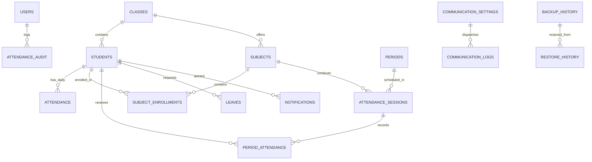

# SMART SCHOOL — Database Schema Specification

The application uses a relational SQLite database (`server/smart_school.db`) running with Write-Ahead Logging (`WAL`) mode and Foreign Key enforcement enabled (`PRAGMA foreign_keys = ON;`).

---

## 1. Entity-Relationship Overview

---

## 2. Table Specifications

### 2.1 Core School Directory

#### `classes`
- `id` (INTEGER PRIMARY KEY AUTOINCREMENT)
- `name` (TEXT UNIQUE NOT NULL) — e.g. "10-A", "10-B"
- `created_at` (DATETIME DEFAULT CURRENT_TIMESTAMP)

#### `students`
- `id` (INTEGER PRIMARY KEY AUTOINCREMENT)
- `admission_no` (TEXT UNIQUE NOT NULL)
- `roll_no` (TEXT NOT NULL)
- `name` (TEXT NOT NULL)
- `dob` (DATE)
- `gender` (TEXT)
- `class_sec` (TEXT NOT NULL, FK -> `classes.name`)
- `parent_name` (TEXT)
- `parent_phone` (TEXT)
- `parent_email` (TEXT)
- `address` (TEXT)
- `photo_url` (TEXT)
- `status` (TEXT DEFAULT 'Active')
- `admission_date` (DATE)
- `created_at` (DATETIME DEFAULT CURRENT_TIMESTAMP)
- **Constraint**: `UNIQUE(class_sec, roll_no)`

#### `teachers`
- `id` (INTEGER PRIMARY KEY AUTOINCREMENT)
- `teacher_id` (TEXT UNIQUE NOT NULL) — e.g. "TCH-101"
- `name` (TEXT NOT NULL)
- `email` (TEXT UNIQUE NOT NULL)
- `phone` (TEXT)
- `subjects` (TEXT) — JSON or comma-separated list
- `classes` (TEXT) — Assigned classes (e.g. "10-A, 10-B")
- `status` (TEXT DEFAULT 'Active')
- `created_at` (DATETIME DEFAULT CURRENT_TIMESTAMP)

#### `users`
- `id` (INTEGER PRIMARY KEY AUTOINCREMENT)
- `username` (TEXT UNIQUE NOT NULL)
- `password_hash` (TEXT NOT NULL) — bcrypt salted hash
- `role` (TEXT NOT NULL) — `admin`, `teacher`, `parent`
- `linked_id` (INTEGER) — Student ID for parents, Teacher ID for faculty
- `full_name` (TEXT)
- `created_at` (DATETIME DEFAULT CURRENT_TIMESTAMP)

---

### 2.2 Academic Subjects & Period Scheduling

#### `periods`
Defines the standard instructional schedule blocks.
- `id` (INTEGER PRIMARY KEY AUTOINCREMENT)
- `period_number` (INTEGER NOT NULL UNIQUE) — 1, 2, 3...
- `name` (TEXT NOT NULL) — e.g. "Period 1", "Morning Lab"
- `start_time` (TEXT NOT NULL) — e.g. "08:30"
- `end_time` (TEXT NOT NULL) — e.g. "09:20"
- `type` (TEXT DEFAULT 'Instructional') — `Instructional`, `Break`, `Assembly`

#### `subjects`
Holds course offerings with granular attendance requirements.
- `id` (INTEGER PRIMARY KEY AUTOINCREMENT)
- `code` (TEXT UNIQUE NOT NULL) — e.g. "MATH-10A", "PHYLAB-10A"
- `name` (TEXT NOT NULL) — "Mathematics Theory"
- `type` (TEXT DEFAULT 'Theory') — `Theory` or `Practical`
- `class_sec` (TEXT NOT NULL, FK -> `classes.name`)
- `min_attendance_pct` (REAL DEFAULT 75.0) — Configurable minimum threshold (e.g. 75.0 for theory, 80.0 for practical lab)
- `created_at` (DATETIME DEFAULT CURRENT_TIMESTAMP)

#### `subject_enrollments`
Maps individual students to their enrolled subjects.
- `id` (INTEGER PRIMARY KEY AUTOINCREMENT)
- `student_id` (INTEGER NOT NULL, FK -> `students.id` ON DELETE CASCADE)
- `subject_id` (INTEGER NOT NULL, FK -> `subjects.id` ON DELETE CASCADE)
- `enrolled_date` (DATE DEFAULT CURRENT_DATE)
- **Constraint**: `UNIQUE(student_id, subject_id)`

#### `timetable`
Class-wise weekly period allocation.
- `id` (INTEGER PRIMARY KEY AUTOINCREMENT)
- `class_sec` (TEXT NOT NULL)
- `day_of_week` (TEXT NOT NULL) — e.g. "Monday"
- `period_number` (INTEGER NOT NULL)
- `subject_id` (INTEGER, FK -> `subjects.id`)
- `teacher_id` (INTEGER, FK -> `teachers.id`)
- `room` (TEXT)

---

### 2.3 Attendance Storage & Audit

#### `attendance` (Daily)
- `id` (INTEGER PRIMARY KEY AUTOINCREMENT)
- `student_id` (INTEGER NOT NULL, FK -> `students.id`)
- `date` (DATE NOT NULL)
- `status` (TEXT NOT NULL) — `Present`, `Absent`, `Late`, `Excused`
- `remarks` (TEXT)
- `marked_by` (TEXT)
- `marked_at` (DATETIME DEFAULT CURRENT_TIMESTAMP)
- **Constraint**: `UNIQUE(student_id, date)`

#### `attendance_sessions` (Period-Wise)
Master header for an academic period session.
- `id` (INTEGER PRIMARY KEY AUTOINCREMENT)
- `date` (DATE NOT NULL)
- `class_sec` (TEXT NOT NULL)
- `subject_id` (INTEGER NOT NULL, FK -> `subjects.id`)
- `period_number` (INTEGER NOT NULL)
- `conducted_by` (TEXT NOT NULL) — Teacher name
- `status` (TEXT DEFAULT 'Completed') — `Completed` or `Cancelled`
- `created_at` (DATETIME DEFAULT CURRENT_TIMESTAMP)
- **Constraint**: `UNIQUE(date, class_sec, period_number, subject_id)`

#### `period_attendance` (Period Marks)
Detailed mark per student per subject period session.
- `id` (INTEGER PRIMARY KEY AUTOINCREMENT)
- `session_id` (INTEGER NOT NULL, FK -> `attendance_sessions.id` ON DELETE CASCADE)
- `student_id` (INTEGER NOT NULL, FK -> `students.id` ON DELETE CASCADE)
- `status` (TEXT NOT NULL) — `Present`, `Absent`, `Late`, `Excused`
- `remarks` (TEXT)
- `marked_at` (DATETIME DEFAULT CURRENT_TIMESTAMP)
- **Constraint**: `UNIQUE(session_id, student_id)`

#### `attendance_audit`
Immutable trail of all attendance corrections.
- `id` (INTEGER PRIMARY KEY AUTOINCREMENT)
- `attendance_id` (INTEGER)
- `student_id` (INTEGER)
- `date` (DATE)
- `old_status` (TEXT)
- `new_status` (TEXT)
- `changed_by` (TEXT)
- `reason` (TEXT)
- `changed_at` (DATETIME DEFAULT CURRENT_TIMESTAMP)

---

### 2.4 Leaves, Notifications & Communications

#### `leaves`
- `id` (INTEGER PRIMARY KEY AUTOINCREMENT)
- `student_id` (INTEGER NOT NULL, FK -> `students.id`)
- `start_date` (DATE NOT NULL)
- `end_date` (DATE NOT NULL)
- `reason` (TEXT NOT NULL)
- `status` (TEXT DEFAULT 'Pending') — `Pending`, `Approved`, `Rejected`
- `reviewed_by` (TEXT)
- `created_at` (DATETIME DEFAULT CURRENT_TIMESTAMP)

#### `notifications` (In-App)
- `id` (INTEGER PRIMARY KEY AUTOINCREMENT)
- `student_id` (INTEGER)
- `title` (TEXT NOT NULL)
- `message` (TEXT NOT NULL)
- `type` (TEXT NOT NULL) — `absence`, `defaulter_alert`, `leave_update`
- `read` (INTEGER DEFAULT 0)
- `created_at` (DATETIME DEFAULT CURRENT_TIMESTAMP)

#### `communication_settings`
Single row storing masked gateway configuration.
- `id` (INTEGER PRIMARY KEY)
- `email_provider` (TEXT DEFAULT 'smtp')
- `smtp_host` (TEXT)
- `smtp_port` (INTEGER DEFAULT 587)
- `smtp_secure` (INTEGER DEFAULT 0)
- `smtp_user` (TEXT)
- `smtp_pass` (TEXT) — Encrypted or raw server credentials
- `smtp_from` (TEXT)
- `sms_provider` (TEXT DEFAULT 'twilio')
- `twilio_account_sid` (TEXT)
- `twilio_auth_token` (TEXT)
- `twilio_from_phone` (TEXT)
- `updated_at` (DATETIME DEFAULT CURRENT_TIMESTAMP)

#### `communication_logs`
Historical log of outbound emails and SMS alerts.
- `id` (INTEGER PRIMARY KEY AUTOINCREMENT)
- `channel` (TEXT NOT NULL) — `email` or `sms`
- `recipient` (TEXT NOT NULL) — Email address or phone number
- `subject` (TEXT)
- `message` (TEXT NOT NULL)
- `provider` (TEXT NOT NULL) — `smtp`, `sendgrid`, `twilio`
- `status` (TEXT NOT NULL) — `sent`, `delivered`, `failed`
- `error_message` (TEXT)
- `dispatched_at` (DATETIME DEFAULT CURRENT_TIMESTAMP)

---

### 2.5 Backup & Restore System

#### `backup_history`
- `id` (INTEGER PRIMARY KEY AUTOINCREMENT)
- `file_name` (TEXT NOT NULL UNIQUE)
- `format` (TEXT NOT NULL) — `sql` or `json`
- `size_bytes` (INTEGER NOT NULL)
- `sha256` (TEXT NOT NULL)
- `created_by` (TEXT DEFAULT 'system')
- `created_at` (DATETIME DEFAULT CURRENT_TIMESTAMP)

#### `restore_history`
- `id` (INTEGER PRIMARY KEY AUTOINCREMENT)
- `backup_file` (TEXT NOT NULL)
- `pre_restore_backup` (TEXT NOT NULL) — Automatic safety snapshot name
- `status` (TEXT NOT NULL) — `success` or `failed`
- `restored_by` (TEXT DEFAULT 'admin')
- `restored_at` (DATETIME DEFAULT CURRENT_TIMESTAMP)

#### `holidays`
- `id` (INTEGER PRIMARY KEY AUTOINCREMENT)
- `date` (DATE UNIQUE NOT NULL)
- `name` (TEXT NOT NULL)
- `type` (TEXT DEFAULT 'Public')

