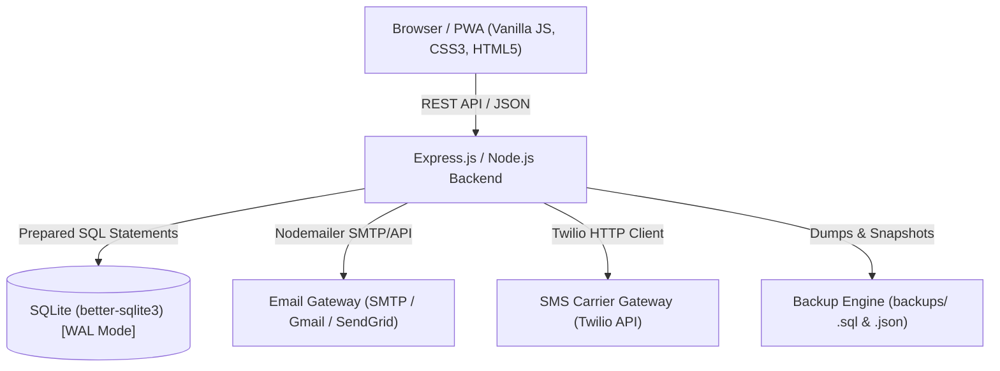

# SMART SCHOOL — Smart Attendance & Academic Operations Management System

> **Version 4.5.0** — Production-ready, full-stack, relational academic management platform featuring **Subject & Period-Wise Attendance**, **Carrier-Grade Email & SMS Communication Gateways (Nodemailer & Twilio)**, **Database Backup, Integrity & Restore Engines**, **Role-Based Access Control**, **75% / 80% Compliance Engines**, **Leave Portals**, and **Predictive AI Insights**.

---

## 1. System Architecture & Tech Stack

SMART SCHOOL is built on a high-throughput, normalized relational architecture designed for modern schools and academic institutions.



### Technology Stack:
- **Frontend**: Responsive HTML5, Vanilla JavaScript (ES6+), CSS3 Design System with Dark Mode, Native HTML5 Canvas Charts (zero external runtime dependencies), Progressive Web App (`manifest.json` and `sw.js`).
- **Backend**: Node.js, Express.js REST API, JSON communication.
- **Database**: Normalized SQLite Relational Database (`better-sqlite3`) with WAL journal mode, Foreign Key constraints, and ACID transactions.
- **Communication**: Nodemailer (SMTP, Gmail with App Passwords, SendGrid), Twilio SMS API with masked secret storage and persistent dispatch logging.
- **Security**: Password hashing with `bcryptjs`, JWT token session management, server-side role authorization (`admin`, `teacher`, `parent`), masked secrets, and SQL audit trail logging.

---

## 2. Key Modules & Functional Overview

### 🏫 Module 1: Subject-Wise & Period-Wise Attendance
- **Period Attendance Interface (`period-attendance.html`)**:
  - Filter by Academic Year, Class, Section, Subject, Period, and Date.
  - Interactive roll-call grid supporting **Present**, **Absent**, **Late**, and **Excused** marks with remark inputs.
  - "Mark All Present" batch action, search filtering, roll number sorting, and submission confirmation modal.
  - Automatic duplicate session prevention.
- **Subject Attendance & Configurable Thresholds (`subject-attendance.html`)**:
  - Configure minimum attendance requirements per subject independently (e.g. Mathematics Theory 75%, Physics Practical Lab 80%).
  - Class-wide roster calculating attended sessions, conducted sessions, percentage, eligibility status, and recovery sessions.
- **Mathematical Recovery Formula**:
  - Computes minimum future consecutive sessions $x$ needed to regain eligibility for target threshold $r$:
    $$x = \max\left(1, \left\lceil \frac{rT - P}{1 - r} \right\rceil\right)$$
- **Student Profile Dossier Integration (`profile.html`)**:
  - Dedicated "Subject-Wise Attendance Performance" section with real-time compliance status and Canvas comparative chart.
- **Teacher Authorization**:
  - Restricts faculty attendance marking strictly to assigned subjects, classes, and periods.

### 📬 Module 2: Email & SMS Communication Gateway
- **Multi-Provider Email (`Nodemailer`)**:
  - Full support for Custom SMTP (Mailgun, Postmark, SES), Gmail (App Passwords), and SendGrid relay.
- **Carrier SMS (`Twilio API`)**:
  - Direct SMS messaging to parent/guardian mobile numbers.
- **Masked Secrets Management (`settings-communication.html`)**:
  - High-security secret masking (`••••••••`) ensuring credentials are never exposed in UI or network inspections.
- **Diagnostic Connection Modals**:
  - On-demand "Test Email Gateway" and "Test SMS Gateway" modals for instant verification.
- **Automated Event Triggers**:
  - Instant dispatch on unexcused absences and falling below subject eligibility thresholds.
- **Dispatch History & Retry Log (`communication-dispatch.html`)**:
  - Auditable dispatch log (`communication_logs`) with status filters and one-click retries for failed deliveries.

### 💾 Module 3: Database Backup, Integrity & Restore
- **Dual Export Formats (`settings-database.html`)**:
  - **SQL Dump (`.sql`)**: Full DDL schema and transactional DML statements for direct SQLite command-line recovery.
  - **Structured JSON (`.json`)**: Human-readable, audited snapshot containing schema metadata and complete table documents.
- **Cryptographic SHA-256 Validation**:
  - Verifies file integrity before any restoration is permitted.
- **Pre-Restore Safety Guarantee**:
  - **Automatically creates a timestamped safety backup snapshot** of the active database before any restoration modifies existing tables.
- **Restore Audit Trail**:
  - Permanent log (`restore_history`) recording operator names, source backups, and statuses.

### 📊 Module A: Main Administrative Dashboard (`index.html`)
- Live aggregated metrics: Total Students, Total Faculty, Present Today, Absent Today, Late Arrivals, Class Attendance %, Subject Defaulters, Gateway Alerts, and Backup Health.
- Interactive Canvas visualizations: Weekly attendance trend curve, status distribution doughnut chart, and class comparison bar chart.
- Keyboard-driven Rapid Speed Roll-Call (<kbd>P</kbd>, <kbd>A</kbd>, <kbd>L</kbd>, <kbd>E</kbd>, <kbd>Esc</kbd>).

### 📅 Module C: Monthly Attendance Calendar (`calendar.html`)
- Color-coded calendar grid: Green (Present), Red (Absent), Yellow (Late), Blue (Excused), Grey (Holiday/Weekend).
- Monthly attendance percentage summary and date-click inspection.

### 👥 Module D & F: Student & Teacher Management (`students.html`, `teachers.html`)
- Unique constraints enforcing roll numbers, admission numbers, and teacher IDs.
- Bulk CSV student import and export.
- Teacher subject and class allocations.

### 📝 Module H: Leave Management Portal (`leaves.html`)
- Guardian/student leave submission workflow.
- Administrator approval/rejection with **automated attendance status synchronization** (approved leaves mark corresponding dates as *Excused*).

### 📑 Module J: Reports & Defaulters Centre (`reports.html`)
- Configurable reports: Daily Audit, 75% Defaulter Recovery Report, Monthly Class Performance, Annual Ledger.
- CSV export with UTF-8 BOM encoding and formatted print view.

---

## 3. Quick Start & Installation

### Prerequisites
- Node.js v18.0.0 or higher
- npm v9.0.0 or higher

### Installation
```bash
# 1. Clone repository and navigate to root
cd "d:\ITWS project"

# 2. Install dependencies
npm install

# 3. Configure environment
cp .env.example .env

# 4. Start the server
npm start
```
The server will start at: **http://localhost:3000**

---

## 4. Default Credentials (Pre-Seeded)

| Role | Username | Password | Purpose |
|---|---|---|---|
| **Administrator** | `admin` | `admin123` | Unrestricted access across all operational modules |
| **Teacher** | `teacher1` | `teacher123` | Class 10-A, 10-B (Mathematics & Physics) |
| **Parent** | `parent1` | `parent123` | Linked to student Aarav Sharma (10A-01) |

*Use the 1-Click Demo Login buttons on `login.html` for instant role switching.*

---

## 5. Automated Testing

Run the automated test suite:
```bash
npm test
```
- **Unit Tests**: 23 / 23 Passed (100%)
- **REST API Integration Tests**: 21 / 21 Passed (100%)
- **Total Passing**: **44 / 44 (100%)**

---

## 6. Complete Documentation Directory

For in-depth architectural and operational guides, consult:
- [API_DOCUMENTATION.md](file:///d:/ITWS%20project/API_DOCUMENTATION.md) — Comprehensive REST API endpoint catalog and schemas.
- [DATABASE_SCHEMA.md](file:///d:/ITWS%20project/DATABASE_SCHEMA.md) — Complete relational ER diagram, table schemas, and foreign keys.
- [BACKUP_AND_RESTORE.md](file:///d:/ITWS%20project/BACKUP_AND_RESTORE.md) — Backup creation, integrity checks, and recovery runbooks.
- [COMMUNICATION_SETUP.md](file:///d:/ITWS%20project/COMMUNICATION_SETUP.md) — Email (SMTP/SendGrid/Gmail) and Twilio SMS configuration.
- [INSTALLATION.md](file:///d:/ITWS%20project/INSTALLATION.md) — Full environment installation and startup guide.
- [SECURITY.md](file:///d:/ITWS%20project/SECURITY.md) — Security policies, password hashing, and masked secret protection.
- [TESTING.md](file:///d:/ITWS%20project/TESTING.md) — Test cases, mathematical specifications, and QA guide.
- [CHANGELOG.md](file:///d:/ITWS%20project/CHANGELOG.md) — Release notes and upgrade history.
- [.env.example](file:///d:/ITWS%20project/.env.example) — Production environment configuration template.
